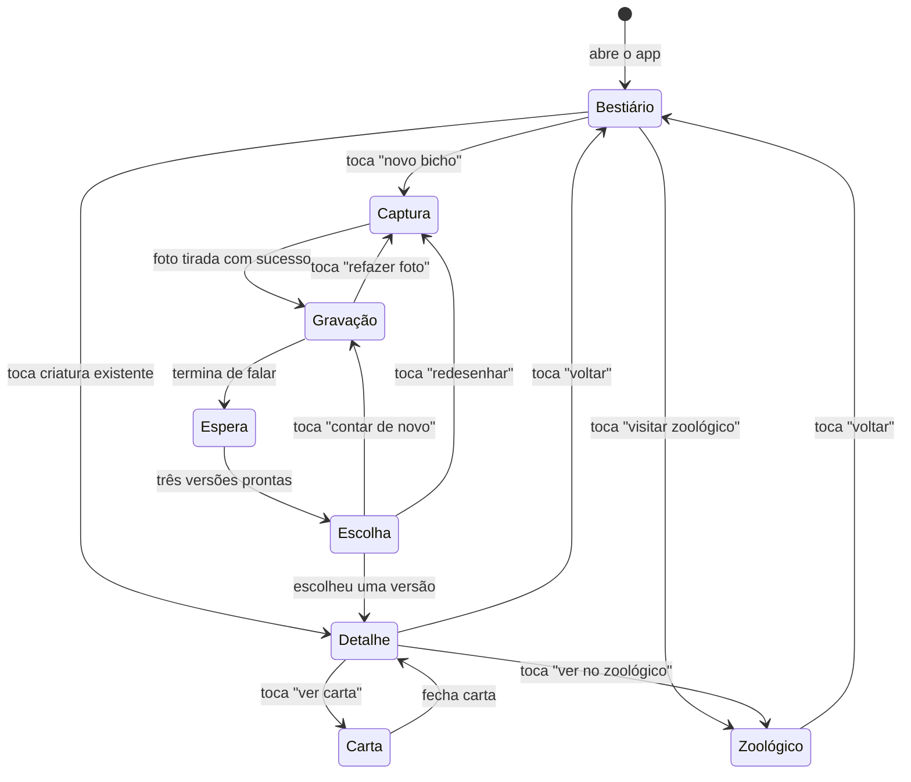
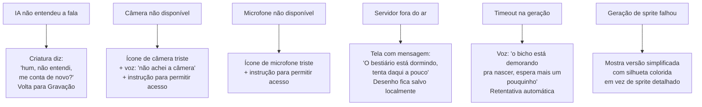
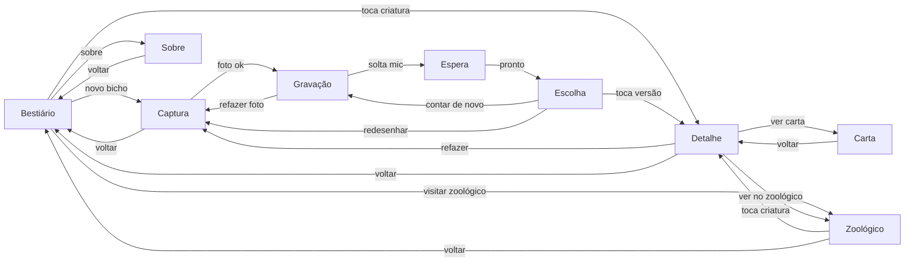

# PF2 — Protótipo de Baixíssima Fidelidade

> O Bestiário do Samuel · Grupo 7 · Criatividade Computacional 2026.2 (IF866, CIn-UFPE)

---

## 1. Resumo

Uma criança de 6 a 9 anos desenha um bicho no papel e conta, falando, como ele é. A IA junta o desenho e a fala e propõe três versões da criatura com aparência e comportamentos. A criança escolhe. A criatura entra no bestiário dela, ganha vida como sprite animado no **zoológico digital** e vira uma **carta para imprimir**.

A interface é pensada para **tablet** (câmera e microfone nativos). Samuel (8 anos) ainda escreve pouco, então toda a navegação funciona por ícones, voz e toque.

---

## 2. Persona

| Campo | Detalhe |
|---|---|
| **Nome** | Samuel |
| **Idade** | 8 anos |
| **Relação** | Primo do Marcos (integrante do grupo) |
| **Contexto** | Joga Minecraft no tablet, inventa mundos, desenha bichos no papel |
| **Necessidade** | Ver os bichos que inventa ganharem vida fora do papel |
| **Limitações** | Não lê prompts longos, não tem conta em serviços de IA, precisa de interface sem texto |

---

## 3. Princípios de Interface

| Princípio | Motivação |
|---|---|
| **Sem texto na navegação** | Samuel escreve pouco. Botões usam ícones grandes com feedback por voz e som |
| **No máximo 3 toques por tarefa** | Criança perde interesse rápido. Fluxo principal: fotografar, falar, escolher |
| **Feedback imediato** | Animação de espera com personagem ("seu bicho está nascendo") em vez de tela vazia |
| **Erro como personagem** | Quando a IA não entende, a criatura responde como se fosse ela ("hum, não entendi, me conta de novo?") |
| **Sem conta e sem login** | Samuel abre o link e usa. A API é do grupo, configurada no servidor |
| **Tablet-first, responsivo** | Câmera e microfone nativos no tablet. O mesmo link abre no computador para a Avaliação Cruzada |

---

## 4. Fluxo do Usuário



---

## 5. Telas

### 5.1 Bestiário (tela inicial)

A primeira tela que Samuel vê ao abrir o app. Um grid de criaturas já criadas, cada uma como miniatura com o nome que ele deu por voz.

```
┌──────────────────────────────────────────────────┐
│                  MEU BESTIÁRIO                   │
│                                                  │
│  ┌──────────┐  ┌──────────┐  ┌──────────┐      │
│  │          │  │          │  │          │      │
│  │ [bicho1] │  │ [bicho2] │  │ [bicho3] │      │
│  │  imagem  │  │  imagem  │  │  imagem  │      │
│  │          │  │          │  │          │      │
│  │  "Fogo"  │  │ "Spike"  │  │ "Bolha"  │      │
│  └──────────┘  └──────────┘  └──────────┘      │
│                                                  │
│  ┌──────────┐                                    │
│  │          │                                    │
│  │ [bicho4] │                                    │
│  │  imagem  │                                    │
│  │          │                                    │
│  │  "Rex"   │                                    │
│  └──────────┘                                    │
│                                                  │
│       ┌────────────────────────┐                 │
│       │   (+) NOVO BICHO       │                 │
│       │   ícone de lápis       │                 │
│       └────────────────────────┘                 │
│                                                  │
│  [mapa] visitar zoológico        [?] sobre       │
└──────────────────────────────────────────────────┘
```

**Elementos:**
- Grid responsivo de cards com miniatura da criatura e nome
- Botão grande "+ NOVO BICHO" (ícone de lápis com estrela)
- Toque no card leva à tela de Detalhe
- Botão "visitar zoológico" (ícone de mapa) leva ao mapa 2D
- Ícone "?" no canto inferior leva à tela Sobre (explica uso de IA)
- No primeiro uso, o bestiário está vazio e uma voz diz "oi! desenha um bicho pra gente começar!"

---

### 5.2 Captura (fotografar o desenho)

Câmera do tablet aberta com visor. Samuel posiciona o papel com o desenho dentro de um guia visual.

```
┌──────────────────────────────────────────────────┐
│  [<] voltar                                      │
│                                                  │
│  ┌──────────────────────────────────────────┐    │
│  │                                          │    │
│  │                                          │    │
│  │        [ VISOR DA CÂMERA ]               │    │
│  │                                          │    │
│  │    ┌ ─ ─ ─ ─ ─ ─ ─ ─ ─ ─ ┐              │    │
│  │    │  guia: "coloca o      │              │    │
│  │    │  desenho aqui dentro" │              │    │
│  │    └ ─ ─ ─ ─ ─ ─ ─ ─ ─ ─ ┘              │    │
│  │                                          │    │
│  └──────────────────────────────────────────┘    │
│                                                  │
│  voz: "coloca o desenho dentro do quadrado"      │
│                                                  │
│           ┌────────────────────┐                 │
│           │   (o) CAPTURAR     │                 │
│           │   ícone de câmera  │                 │
│           └────────────────────┘                 │
└──────────────────────────────────────────────────┘
```

**Elementos:**
- Visor da câmera com guia de enquadramento (retângulo tracejado)
- Instrução por voz: "coloca o desenho dentro do quadrado"
- Botão grande de captura (ícone de câmera)
- Após capturar, mostra preview com duas opções: "usar esta foto" ou "tirar de novo"
- Botão voltar no canto superior esquerdo

---

### 5.3 Gravação (contar como o bicho é)

Após fotografar, Samuel descreve o bicho falando. O botão de microfone funciona como walkie-talkie: pressiona e segura para gravar.

```
┌──────────────────────────────────────────────────┐
│  [<] voltar                                      │
│                                                  │
│  ┌──────────────────┐                            │
│  │                  │  voz: "agora me conta      │
│  │ [preview da foto]│   como é o seu bicho!"     │
│  │  (miniatura)     │                            │
│  │                  │                            │
│  └──────────────────┘                            │
│                                                  │
│                                                  │
│           ┌────────────────────┐                 │
│           │                    │                 │
│           │   (mic) SEGURA     │                 │
│           │    PRA FALAR       │                 │
│           │                    │                 │
│           └────────────────────┘                 │
│                                                  │
│  ~~~ ondas sonoras animadas enquanto grava ~~~   │
│                                                  │
│  [ícone câmera] refazer foto                     │
└──────────────────────────────────────────────────┘
```

**Elementos:**
- Preview pequena da foto do desenho para dar contexto
- Instrução por voz: "agora me conta como é o seu bicho!"
- Botão de microfone grande, estilo walkie-talkie (press-and-hold)
- Animação de ondas sonoras durante a gravação
- Link "refazer foto" volta para a tela de Captura
- Ao soltar o botão, o áudio é enviado e a tela avança para Espera

---

### 5.4 Espera (processamento)

Tela de loading enquanto a IA processa o desenho e a fala. Usa animação temática para manter a atenção da criança.

```
┌──────────────────────────────────────────────────┐
│                                                  │
│                                                  │
│                                                  │
│           ┌────────────────────┐                 │
│           │                    │                 │
│           │   animação de      │                 │
│           │   ovo chocando     │                 │
│           │                    │                 │
│           └────────────────────┘                 │
│                                                  │
│        "seu bicho está nascendo..."              │
│                                                  │
│        ████████░░░░░░░░░░░░░░░░                  │
│        (barra de progresso sutil)                │
│                                                  │
│                                                  │
└──────────────────────────────────────────────────┘
```

**Elementos:**
- Animação temática (ovo chocando, nuvem de fumaça, pegadas aparecendo)
- Voz: "seu bicho está nascendo"
- Barra de progresso visual, sem números
- Nenhum botão nesta tela. A criança espera (alvo: menos de 30 segundos)

---

### 5.5 Escolha (três versões lado a lado)

Samuel vê três interpretações da criatura e escolhe uma. Cada versão mostra a aparência e os comportamentos propostos.

```
┌──────────────────────────────────────────────────┐
│  [<] voltar                                      │
│                                                  │
│  voz: "olha só! nasceram três bichos.            │
│        qual você quer?"                          │
│                                                  │
│  ┌────────────┐ ┌────────────┐ ┌────────────┐   │
│  │            │ │            │ │            │   │
│  │ [versão 1] │ │ [versão 2] │ │ [versão 3] │   │
│  │  imagem    │ │  imagem    │ │  imagem    │   │
│  │            │ │            │ │            │   │
│  │ corpo:     │ │ corpo:     │ │ corpo:     │   │
│  │ lobo       │ │ gato       │ │ morcego    │   │
│  │            │ │            │ │            │   │
│  │ (ico) voa  │ │ (ico) nada │ │ (ico)      │   │
│  │ (ico)      │ │ (ico)      │ │ cospe fogo │   │
│  │ cospe fogo │ │ amigável   │ │ (ico)      │   │
│  │            │ │            │ │ foge gato  │   │
│  └────────────┘ └────────────┘ └────────────┘   │
│                                                  │
│  [contar de novo]            [redesenhar]        │
└──────────────────────────────────────────────────┘
```

**Elementos:**
- Três cards lado a lado, cada um com:
  - Imagem gerada da criatura (sprite com cores do desenho)
  - Nome do corpo-base sugerido (lobo, gato, morcego)
  - Lista de comportamentos propostos com ícones
- Instrução por voz explicando as opções
- Toque no card seleciona a versão e avança para Detalhe
- "Contar de novo" volta para Gravação (refazer a descrição)
- "Redesenhar" volta para Captura (tirar outra foto)

---

### 5.6 Detalhe da Criatura

Página da criatura escolhida com imagem ampliada, nome, comportamentos e ações disponíveis.

```
┌──────────────────────────────────────────────────┐
│  [<] bestiário                                   │
│                                                  │
│  ┌──────────────────────────────────────────┐    │
│  │                                          │    │
│  │      [ imagem grande da criatura ]       │    │
│  │                                          │    │
│  └──────────────────────────────────────────┘    │
│                                                  │
│  nome: "FOGO" (editável por voz)                 │
│  corpo: lobo                                     │
│                                                  │
│  comportamentos:                                 │
│    (ico) cospe fogo                              │
│    (ico) tem medo de gato                        │
│    (ico) mora no vulcão                          │
│                                                  │
│  ┌───────────────────┐  ┌───────────────────┐    │
│  │ (carta) VER CARTA │  │ (mapa) VER NO     │    │
│  │                   │  │  ZOOLÓGICO         │    │
│  └───────────────────┘  └───────────────────┘    │
│                                                  │
│  [refazer este bicho]                            │
└──────────────────────────────────────────────────┘
```

**Elementos:**
- Imagem ampliada da criatura (sprite gerado pela IA)
- Nome dado por Samuel (via voz), editável tocando no nome
- Corpo-base e lista de comportamentos com ícones
- Botão "Ver carta" gera e mostra a carta para imprimir
- Botão "Ver no zoológico" abre o mapa 2D com destaque nessa criatura
- "Refazer este bicho" reinicia o fluxo desde a Captura

---

### 5.7 Zoológico Digital (mapa 2D com sprites)

Mapa 2D visto de cima onde todas as criaturas do bestiário vivem. Cada sprite anda, voa, nada ou interage de acordo com o comportamento que Samuel escolheu.

```
┌──────────────────────────────────────────────────┐
│  [<] bestiário                                   │
│                                                  │
│  ┌──────────────────────────────────────────┐    │
│  │  ~~~~          [montanha]     ~~~~       │    │
│  │  ~~~~  "Bolha"               ~~~~       │    │
│  │  ~~~~   <°)))><    "Fogo"    ~~~~       │    │
│  │           água    /\_/\  fogo            │    │
│  │                  ( o.o )                 │    │
│  │   [árvore]        > ^ <    [vulcão]     │    │
│  │                                          │    │
│  │          "Spike"                         │    │
│  │    "Rex"   /\  /\           [caverna]    │    │
│  │   >=<     (  ^^  )                       │    │
│  │    grama    \/  \/    flores             │    │
│  │                                          │    │
│  └──────────────────────────────────────────┘    │
│                                                  │
│  toque em uma criatura para ver detalhes         │
│                                                  │
│  criaturas: 4          [zoom +] [zoom -]         │
└──────────────────────────────────────────────────┘
```

**Elementos:**
- Mapa 2D com biomas temáticos (água, grama, vulcão, caverna, montanha, floresta)
- Cada criatura aparece como sprite animado no bioma correspondente:
  - "Nada" fica na água
  - "Mora no vulcão" fica perto do vulcão
  - "Voa" flutua sobre o mapa
  - "É amigável" segue outras criaturas
  - "Foge de gato" corre de criaturas felinas
- Toque na criatura mostra nome e abre menu para ir ao Detalhe
- Controles de zoom para tablets menores
- Contador de criaturas no mapa
- O mapa cresce conforme o bestiário cresce (novos biomas aparecem)

**Biomas disponíveis:**

| Bioma | Comportamentos relacionados |
|---|---|
| Lago/Rio | nada, bebe água, pesca |
| Vulcão | cospe fogo, mora no vulcão, resiste ao calor |
| Floresta | se esconde, escala árvore, come frutas |
| Caverna | noturno, mora na caverna, tem medo de luz |
| Planície | corre, é amigável, segue o dono |
| Céu | voa, flutua, mora nas nuvens |

---

### 5.8 Carta para Imprimir

Preview da carta de coleção. Formato de card game com ilustração, nome e atributos da criatura.

```
┌──────────────────────────────────────────────────┐
│  [<] voltar                  [impressora] imprimir│
│                                                  │
│         ┌───────────────────────────┐            │
│         │  ┌─────────────────────┐  │            │
│         │  │                     │  │            │
│         │  │  ilustração grande  │  │            │
│         │  │  da criatura        │  │            │
│         │  │                     │  │            │
│         │  └─────────────────────┘  │            │
│         │                           │            │
│         │  FOGO                     │            │
│         │  ─────────────────────    │            │
│         │  corpo: lobo              │            │
│         │  ─────────────────────    │            │
│         │  * cospe fogo             │            │
│         │  * tem medo de gato       │            │
│         │  * mora no vulcão         │            │
│         │  ─────────────────────    │            │
│         │  ┌──────────┐            │            │
│         │  │ desenho   │ "criado   │            │
│         │  │ original  │  por      │            │
│         │  │ (mini)    │  Samuel"  │            │
│         │  └──────────┘            │            │
│         └───────────────────────────┘            │
│                                                  │
│  [salvar como imagem]                            │
└──────────────────────────────────────────────────┘
```

**Elementos:**
- Preview da carta em formato retrato
- Ilustração da criatura (a mesma usada no bestiário)
- Nome, corpo-base e lista de comportamentos
- Miniatura do desenho original no canto inferior (referência ao papel)
- Crédito "criado por Samuel" (ou o nome que a criança disser)
- Botão imprimir (abre diálogo nativo do navegador)
- Botão salvar como imagem (download PNG)

---

### 5.9 Sobre

Exigência do lançamento da disciplina: "deixar claro como chegar ao modelo" e "onde a IA entra".

```
┌──────────────────────────────────────────────────┐
│  [<] voltar                                      │
│                                                  │
│  O BESTIÁRIO DO SAMUEL                           │
│                                                  │
│  "Esta ferramenta usa inteligência               │
│   artificial para transformar o seu              │
│   desenho e a sua voz em criaturas!"             │
│                                                  │
│  Como funciona:                                  │
│  1. Você desenha e a câmera fotografa            │
│  2. Você conta e o microfone escuta              │
│  3. A IA cria três versões do bicho              │
│  4. Você escolhe a que mais gosta                │
│                                                  │
│  Feito por: Grupo 7                              │
│  Júlia, Daniel, Sofia, Marcos,                   │
│  Guilherme, Gabriel                              │
│                                                  │
│  CIn-UFPE · Criatividade Computacional 2026.2    │
└──────────────────────────────────────────────────┘
```

---

## 6. Estados de Erro

A ferramenta trata erros como personagem, mantendo o tom lúdico adequado para uma criança de 8 anos.



---

## 7. Mapa de Navegação Completo



---

## 8. Decisões de Design Abertas

| Decisão | Opções | Quando resolver |
|---|---|---|
| Nome da criatura | Samuel fala o nome durante a Gravação vs. tela separada para nomear | Teste com Samuel (PF4) |
| Walkie-talkie vs. toggle | Segurar botão vs. tocar para começar e parar gravação | Teste com Samuel |
| Áudio de instrução | Gravado por voz humana vs. gerado por TTS | Protótipo funcional (PF4) |
| Bestiário vazio | Mensagem de boas-vindas por voz vs. criatura de exemplo pré-carregada | Teste com Samuel |
| Estilo visual do zoológico | Pixel art (estilo retro) vs. ilustração infantil vs. flat design | Definir com o grupo |
| Tamanho do mapa | Mapa fixo com áreas vs. mapa que cresce conforme criaturas são criadas | Protótipo funcional (PF4) |
| Interação entre criaturas | Criaturas interagem entre si no zoológico vs. cada uma independente | Depende da complexidade do motor |
