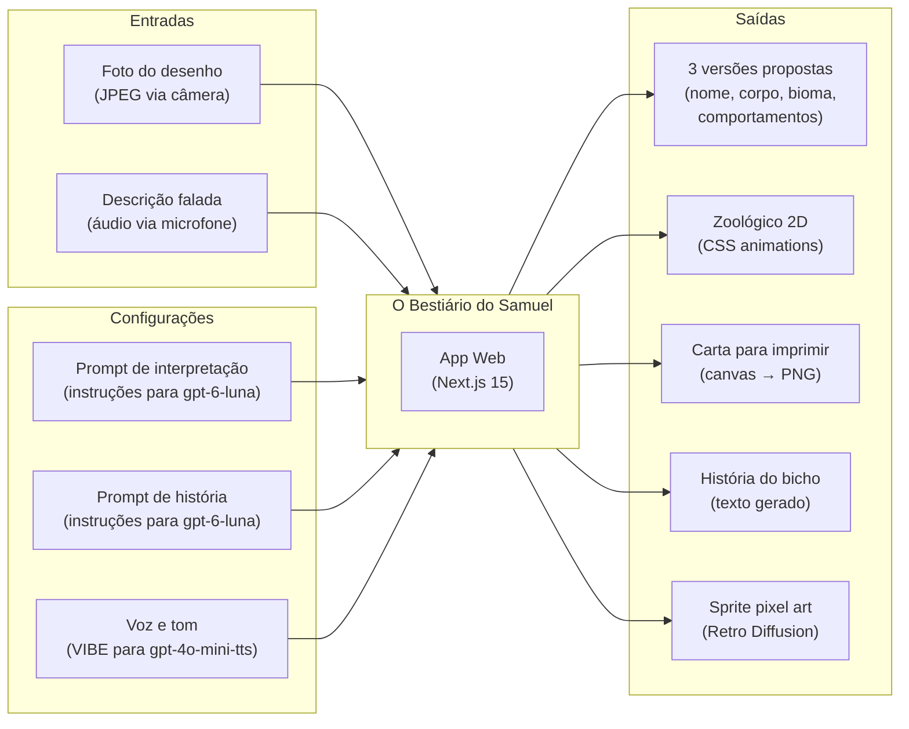
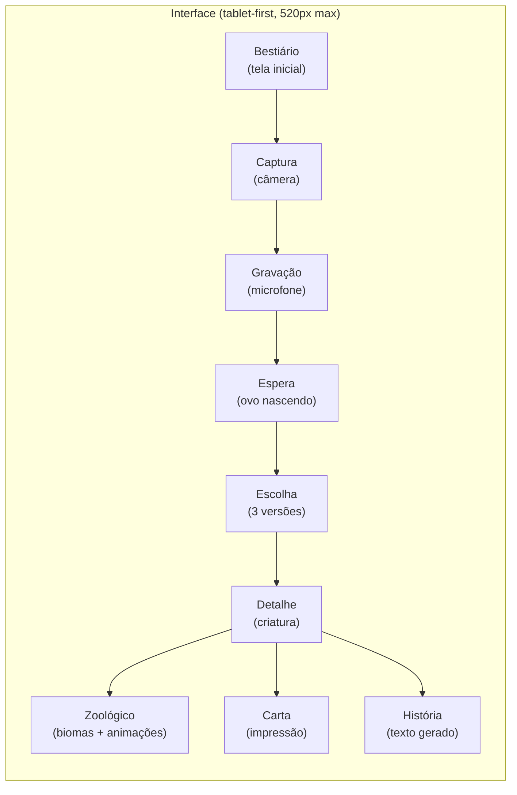
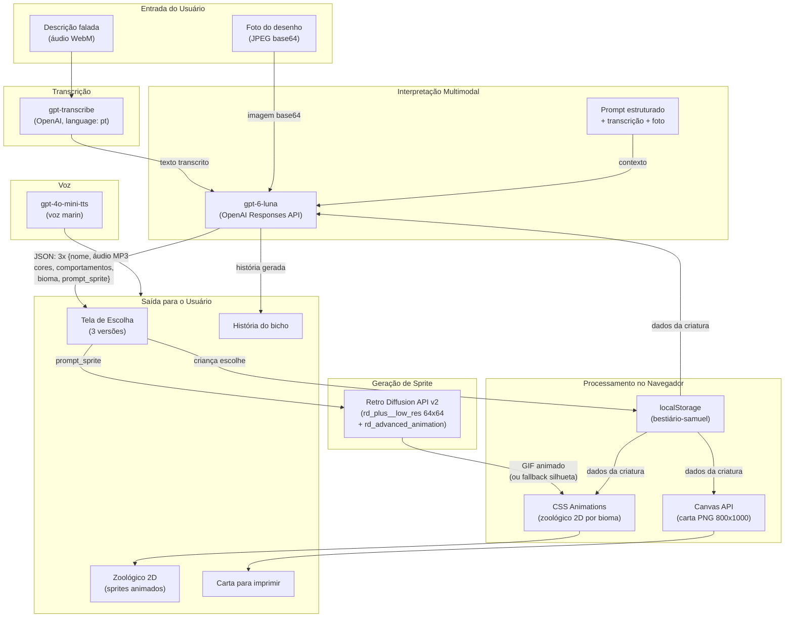
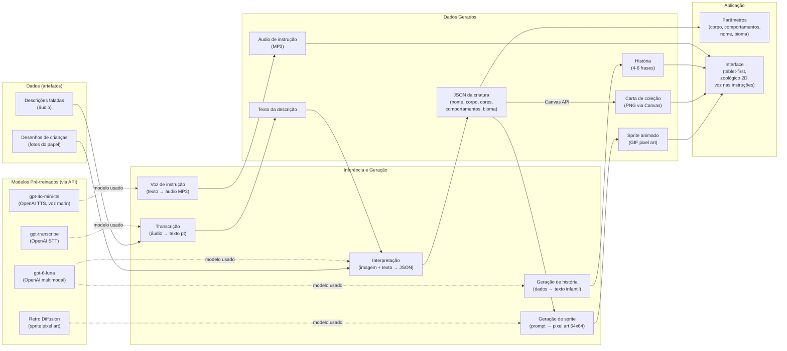
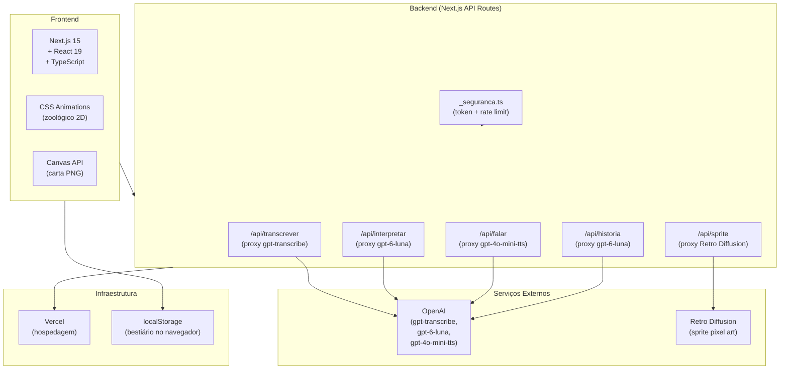
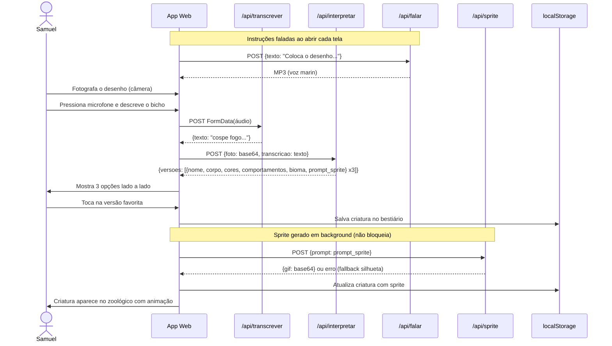
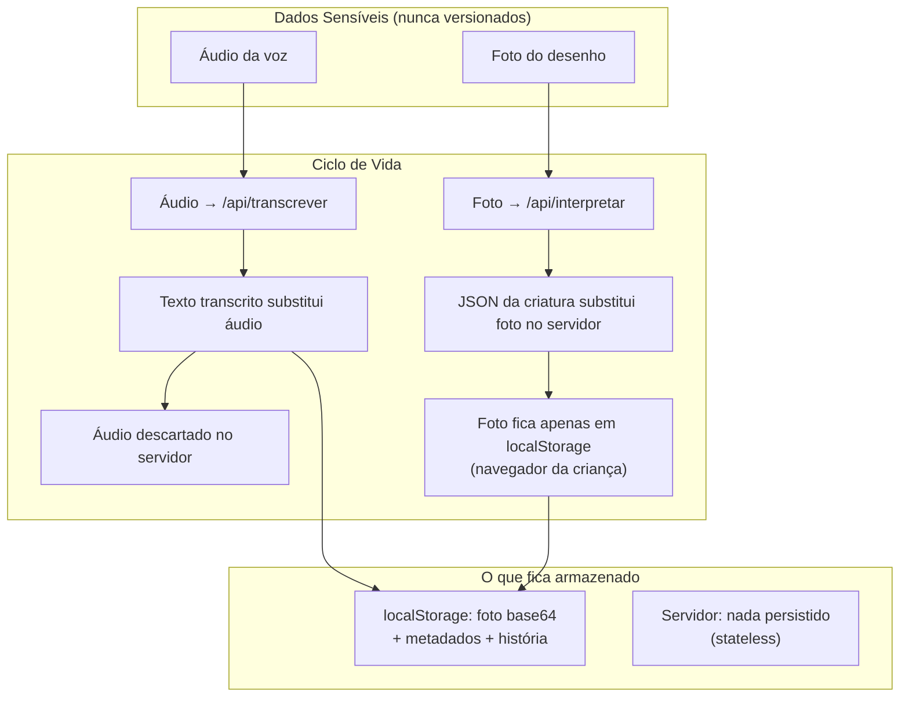

# PF3 — Diagrama de Arquitetura

> O Bestiário do Samuel · Grupo 7 · Criatividade Computacional 2026.2 (IF866, CIn-UFPE)

---

## 1. Análise Caixa Preta

Visão externa da ferramenta: o que entra, o que sai e quais configurações existem.



### Detalhamento das entradas e saídas

| Tipo | Item | Formato | Descrição |
|---|---|---|---|
| **Entrada** | Foto do desenho | JPEG via `getUserMedia` (câmera traseira) | Desenho livre da criança feito no papel |
| **Entrada** | Descrição falada | WebM via `MediaRecorder` | A criança conta como o bicho é, o que faz, onde mora |
| **Config** | Prompt de interpretação | Texto fixo no código | Instrui gpt-6-luna a retornar JSON com 3 versões |
| **Config** | Prompt de história | Texto fixo no código | Instrui gpt-6-luna a gerar história de 4-6 frases |
| **Config** | Voz e tom (VIBE) | Texto fixo no código | Direciona gpt-4o-mini-tts (voz marin, tom infantil) |
| **Saída** | 3 versões | JSON (nome, corpo, cores, comportamentos, bioma, prompt_sprite) | Criança escolhe uma |
| **Saída** | Zoológico 2D | HTML/CSS com animações por comportamento | Criaturas agrupadas por bioma com movimento |
| **Saída** | Carta | PNG gerado via Canvas API | Para imprimir ou salvar como imagem |
| **Saída** | História | Texto gerado por gpt-6-luna | 4-6 frases sobre a criatura |
| **Saída** | Sprite | GIF animado pixel art (64x64) via Retro Diffusion | Fallback: foto com filtro CSS (silhueta) |

---

## 2. Interface com o Usuário

Referência completa: [PF2 — Protótipo de Baixíssima Fidelidade](PF2-Prototipo-Baixa-Fidelidade.md)



---

## 3. Análise Caixa Transparente — Pipeline Completo

Visão interna: módulos, serviços externos e fluxo de dados.



---

## 4. Mapping AI Process

Adaptação do diagrama "Mapping AI Process" (Calegario) para o contexto da ferramenta.



### Legenda

| Símbolo | Significado |
|---|---|
| Retângulo com cantos arredondados | **Artefato** (dado, arquivo, recurso) |
| Retângulo com cantos retos | **Processo** (transformação, inferência) |
| Seta sólida | Fluxo de dados |
| Seta tracejada | Modelo utilizado pelo processo |

### Onde a IA entra

| Componente | Modelo | Papel | Sem IA, o que acontece? |
|---|---|---|---|
| **Transcrição** | gpt-transcribe (OpenAI) | Transcreve a fala da criança para texto em português | A criança precisaria digitar, inviável com 8 anos |
| **Interpretação** | gpt-6-luna (OpenAI) | Interpreta desenho + descrição, propõe corpo, cores, comportamentos e bioma | Não haveria interpretação automática do desenho livre |
| **Sprite** | Retro Diffusion API | Gera sprite pixel art 64x64 animado a partir do prompt_sprite | Foto do desenho usada como fallback (silhueta CSS) |
| **Voz** | gpt-4o-mini-tts (OpenAI) | Fala as instruções para a criança ("coloca o desenho dentro do quadrado") | Criança precisaria ler, difícil com 8 anos |
| **História** | gpt-6-luna (OpenAI) | Gera história curta sobre a criatura a partir dos dados e da transcrição | Não haveria história |

Nenhum modelo é treinado ou ajustado pelo grupo. Todos são usados via API com prompts específicos.

---

## 5. Stack Tecnológica



### Escolha de cada tecnologia

| Camada | Tecnologia | Justificativa |
|---|---|---|
| **Frontend** | Next.js 15 + React 19 | App Router, deploy simples na Vercel, TypeScript |
| **Zoológico 2D** | CSS Animations | Animações por comportamento (voa, nada, corre, fogo) sem game engine |
| **Backend** | Next.js API Routes (Node.js) | Proxy para APIs externas, sem expor chaves no frontend |
| **Transcrição** | OpenAI gpt-transcribe | STT otimizado para português, `language: "pt"` para voz de criança |
| **Interpretação** | OpenAI gpt-6-luna | Multimodal (imagem + texto), retorna JSON estruturado com 3 versões |
| **Voz (TTS)** | OpenAI gpt-4o-mini-tts (voz marin) | Voz quente e infantil para instruções, com VIBE prompt detalhado |
| **História** | OpenAI gpt-6-luna | Gera história de 4-6 frases a partir dos dados da criatura |
| **Sprite** | Retro Diffusion API v2 | Pixel art 64x64 com animação walking. Fallback: silhueta CSS |
| **Armazenamento** | localStorage (navegador) | Sem servidor de banco. Chave `bestiario-samuel`, dados em JSON |
| **Segurança** | Token APP_SECRET + rate limit 30 req/min/IP | Protege rotas antes do deploy público |
| **Hospedagem** | Vercel | Deploy automático, HTTPS nativo, variáveis de ambiente seguras |

---

## 6. Fluxo de Dados Detalhado

Sequência completa de uma criação de criatura.



---

## 7. Estrutura do Projeto

```
criacomp-ferramenta-grupo7/
├── app/
│   ├── page.tsx                   # UI completa (state machine de 9 etapas)
│   ├── layout.tsx                 # Root layout (pt-BR)
│   ├── globals.css                # Estilos (mobile-first, animações, biomas)
│   └── api/
│       ├── _seguranca.ts          # Token + rate limit (compartilhado)
│       ├── transcrever/route.ts   # gpt-transcribe (STT)
│       ├── interpretar/route.ts   # gpt-6-luna (multimodal)
│       ├── falar/route.ts         # gpt-4o-mini-tts (TTS)
│       ├── historia/route.ts      # gpt-6-luna (história)
│       └── sprite/route.ts        # Retro Diffusion (sprite)
│
├── docs/                          # Documentação (PF0-PF3, pitch, processo)
├── .env.example                   # Template de variáveis de ambiente
├── .gitignore                     # Bloqueia mídia do Samuel (menor)
├── package.json                   # Next.js 15, React 19, OpenAI SDK
├── tsconfig.json
└── README.md
```

---

## 8. Privacidade e Segurança

Samuel é menor de idade. O sistema protege os dados dele.



### Medidas de proteção

| Medida | Implementação |
|---|---|
| Sem login e sem conta | Samuel não fornece nome, email nem senha |
| Áudio descartado após transcrição | O servidor não persiste o arquivo de áudio |
| Servidor stateless | Nenhum dado é salvo no servidor. Tudo fica em localStorage no navegador |
| Foto apenas local | A foto base64 fica em localStorage, nunca sobe para banco de dados |
| `.gitignore` bloqueia mídia | Áudio, foto e vídeo bloqueados por padrão no repositório |
| `dados-samuel/` ignorada | Material de teste fica apenas na máquina de quem testa |
| Chaves no servidor | OPENAI_API_KEY e RD_API_KEY ficam nas variáveis de ambiente da Vercel |
| Token de acesso | Rotas /api/* protegidas por APP_SECRET + rate limit 30 req/min/IP |
| Autorização dos pais | Registrada em 17/10/2026 |

---

## 9. Riscos Técnicos e Mitigações

| Risco | Impacto | Mitigação |
|---|---|---|
| **gpt-transcribe não entender voz de criança** | Transcrição errada | `language: "pt"` + botão "contar de novo" + mensagem "hum, não entendi" |
| **gpt-6-luna interpretar mal o desenho** | Criatura não combina | 3 versões para escolher + prompt com instruções detalhadas |
| **Retro Diffusion sem saldo** | Sem sprite | Fallback: foto com filtro CSS (silhueta colorida) |
| **JSON da IA com markdown fences** | Parse falha | `limparJSON()` remove fences antes de `JSON.parse` |
| **Latência do pipeline (>30s)** | Criança perde interesse | Tela de espera com ovo animado + mensagem se demorar |
| **localStorage cheio (~5MB)** | Não salva novas criaturas | Aceitável para demo. Fotos base64 ~100-200KB cada |
| **API abusada sem token** | Gasta créditos | APP_SECRET + rate limit antes do deploy |

---

## 10. Custo Estimado por Criatura

| Etapa | API | Custo estimado |
|---|---|---|
| Transcrição | gpt-transcribe | ~US$ 0,006 (~10s de áudio) |
| Interpretação | gpt-6-luna (multimodal) | ~US$ 0,01-0,03 (1 imagem + texto) |
| Sprite | Retro Diffusion (64x64 + animação) | ~US$ 0,20 |
| Voz (instruções) | gpt-4o-mini-tts | ~US$ 0,005 por frase |
| História | gpt-6-luna (texto) | ~US$ 0,005 |
| **Total por criatura** | | **~US$ 0,25** |

Para 50 criaturas (testes + demo + Avaliação Cruzada): **~US$ 12,50**.
