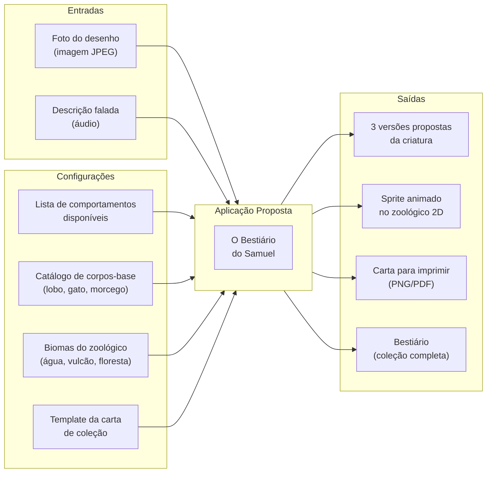
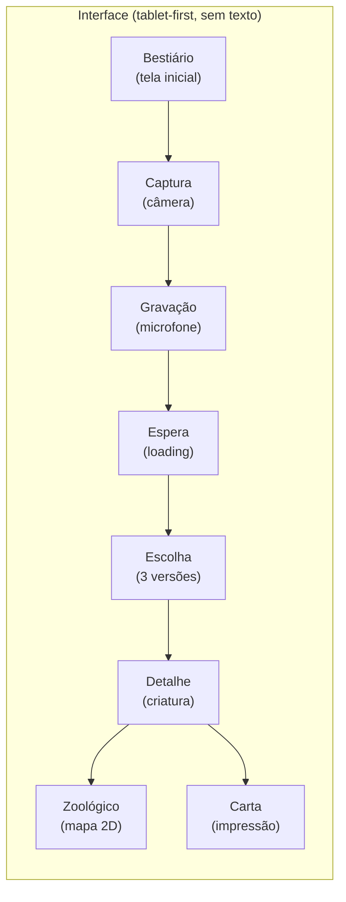
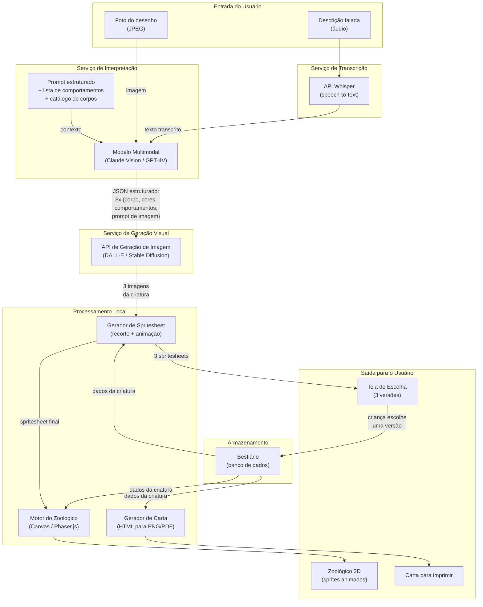
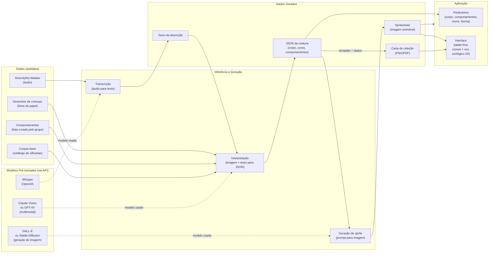
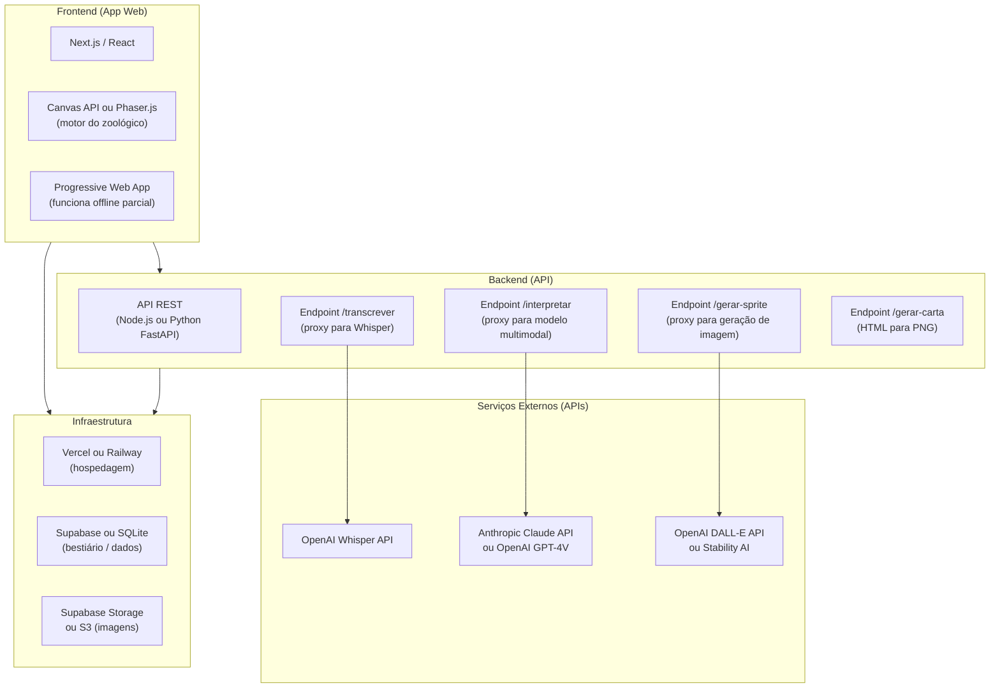
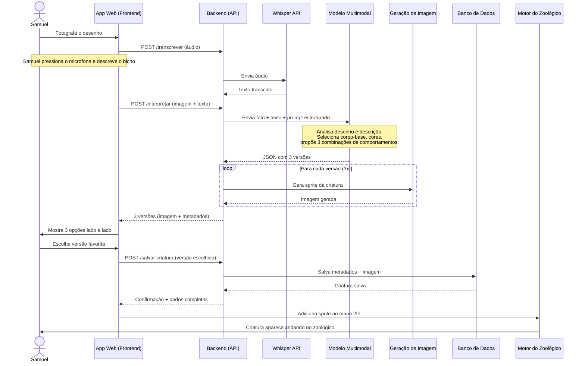
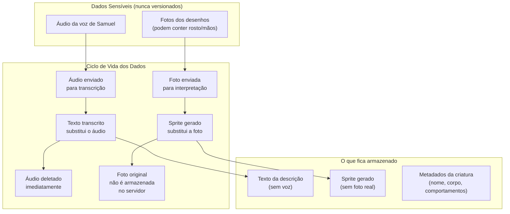

# PF3 — Diagrama de Arquitetura

> O Bestiário do Samuel · Grupo 7 · Criatividade Computacional 2026.2 (IF866, CIn-UFPE)

---

## 1. Análise Caixa Preta

Visão externa da ferramenta: o que entra, o que sai e quais configurações existem.



### Detalhamento das entradas e saídas

| Tipo | Item | Formato | Descrição |
|---|---|---|---|
| **Entrada** | Foto do desenho | JPEG/PNG via câmera do tablet | Desenho livre da criança feito no papel |
| **Entrada** | Descrição falada | Áudio WAV/WebM via microfone | A criança conta como o bicho é, o que faz, onde mora |
| **Config** | Comportamentos | JSON (lista fixa) | Comportamentos que a IA pode propor (voa, nada, cospe fogo, é amigável, foge de gato) |
| **Config** | Corpos-base | JSON (catálogo) | Silhuetas base para os sprites (lobo, gato, morcego, peixe, pássaro, inseto) |
| **Config** | Biomas | JSON (mapa) | Áreas do zoológico e quais comportamentos ficam alocados em cada bioma |
| **Config** | Template de carta | HTML/CSS (template) | Layout da carta de coleção com campos dinâmicos |
| **Saída** | 3 versões | Imagem + JSON | Três interpretações da criatura, cada uma com sprite, corpo-base e comportamentos |
| **Saída** | Sprite animado | PNG (spritesheet) | Sprite com animações básicas (parado, andando, ação especial) |
| **Saída** | Carta | PNG ou PDF | Carta de coleção para impressão com ilustração, nome e atributos |
| **Saída** | Bestiário | JSON + imagens | Coleção de todas as criaturas criadas pela criança |

---

## 2. Interface com o Usuário

Referência completa: [PF2 — Protótipo de Baixíssima Fidelidade](PF2-Prototipo-Baixa-Fidelidade.md)



---

## 3. Análise Caixa Transparente — Pipeline Completo

Visão interna da ferramenta: os módulos, serviços externos e como os dados fluem entre eles.



---

## 4. Mapping AI Process

Adaptação do diagrama "Mapping AI Process" (Calegario) para o contexto da ferramenta.



### Legenda

| Símbolo | Significado |
|---|---|
| Retângulo com cantos arredondados | **Artefato** (dado, arquivo, recurso) |
| Retângulo com cantos retos | **Processo** (transformação, inferência) |
| Seta sólida | Fluxo de dados |
| Seta tracejada | Modelo utilizado pelo processo |

### Onde a IA entra

| Componente | Tipo de IA | Papel | Sem IA, o que acontece? |
|---|---|---|---|
| **Whisper** | Speech-to-text (pré-treinado) | Transcreve a fala da criança para texto | A criança precisaria digitar, o que não é viável com 8 anos |
| **Modelo multimodal** | Vision + Language (pré-treinado) | Interpreta o desenho junto com a descrição e propõe corpo, cores e comportamentos | Não haveria interpretação automática do desenho livre |
| **Geração de imagem** | Text/Image-to-image (pré-treinado) | Gera o sprite da criatura a partir da interpretação | O grupo precisaria desenhar cada criatura manualmente |

Nenhum modelo é treinado ou ajustado pelo grupo. Todos são usados via API com prompts específicos para o contexto do bestiário.

---

## 5. Stack Tecnológica



### Escolha de cada tecnologia

| Camada | Tecnologia | Justificativa |
|---|---|---|
| **Frontend** | Next.js + React | Ecossistema amplo, deploy simples na Vercel, SSR para performance no tablet |
| **Zoológico 2D** | Phaser.js ou Canvas API | Phaser tem sistema de sprites, animação e física 2D prontos. Canvas puro é alternativa mais leve |
| **Backend** | Node.js (Express/Fastify) ou Python (FastAPI) | Proxy para as APIs externas, sem expor chaves no frontend |
| **Transcrição** | OpenAI Whisper API | Funciona bem com português e voz de criança, custo baixo (centavos por chamada) |
| **Interpretação** | Claude Vision (Anthropic) ou GPT-4V (OpenAI) | Modelo multimodal que lê imagem e texto juntos. Claude Vision tende a ser mais preciso em instruções estruturadas |
| **Geração de imagem** | DALL-E 3 (OpenAI) ou Stable Diffusion (Stability AI) | Gera sprite a partir de prompt. DALL-E é mais simples de integrar. SD permite mais controle |
| **Banco** | Supabase (PostgreSQL) ou SQLite | Armazena o bestiário (metadados das criaturas). Supabase tem auth e storage integrados |
| **Storage** | Supabase Storage ou S3 | Armazena imagens dos sprites e fotos dos desenhos |
| **Hospedagem** | Vercel | Deploy automático a cada push, funciona fora da máquina do grupo, HTTPS nativo |

---

## 6. Fluxo de Dados Detalhado

Sequência completa de uma criação de criatura, do desenho ao zoológico.



---

## 7. Estrutura do Projeto

Organização planejada dos diretórios do repositório quando o código for implementado.

```
criacomp-ferramenta-grupo7/
├── docs/                              # Documentação do projeto
│   ├── 0-Dossie-completo.pdf
│   ├── 1-Entregas/                    # PDFs e markdowns das entregas
│   │   ├── PF0-Caixa-Morfologica-Grupo7.pdf
│   │   ├── PF1-Slides-do-Pitch-Grupo7.pdf
│   │   ├── PF2-Prototipo-Baixa-Fidelidade.md
│   │   └── PF3-Diagrama-Arquitetura.md
│   ├── 2-Pitch/
│   ├── 3-Processo-PF0/
│   ├── 4-Plano-tecnico/
│   └── 5-Contexto-da-disciplina/
│
├── src/                               # Código-fonte
│   ├── app/                           # Frontend Next.js (App Router)
│   │   ├── page.tsx                   # Tela do bestiário
│   │   ├── captura/page.tsx           # Tela da câmera
│   │   ├── gravacao/page.tsx          # Tela do microfone
│   │   ├── escolha/page.tsx           # Tela das 3 versões
│   │   ├── criatura/[id]/page.tsx     # Detalhe da criatura
│   │   ├── zoologico/page.tsx         # Mapa 2D
│   │   ├── carta/[id]/page.tsx        # Carta para imprimir
│   │   └── sobre/page.tsx             # Sobre
│   │
│   ├── components/                    # Componentes reutilizáveis
│   │   ├── BotaoGrande.tsx            # Botões com ícone (sem texto)
│   │   ├── CardCriatura.tsx           # Card do bestiário
│   │   ├── SpritePreview.tsx          # Preview animada do sprite
│   │   └── VozInstrucao.tsx           # Componente de instrução por voz
│   │
│   ├── zoo/                           # Motor do zoológico 2D
│   │   ├── engine.ts                  # Loop principal do canvas/Phaser
│   │   ├── mapa.ts                    # Definição de biomas e tiles
│   │   ├── criatura-sprite.ts         # Classe do sprite animado
│   │   └── comportamentos.ts          # Lógica de cada comportamento
│   │
│   └── lib/                           # Utilitários e clients de API
│       ├── api.ts                     # Client para o backend
│       └── tipos.ts                   # Tipos TypeScript compartilhados
│
├── api/                               # Backend (API Routes ou servidor separado)
│   ├── transcrever.ts                 # Proxy para Whisper
│   ├── interpretar.ts                 # Proxy para modelo multimodal
│   ├── gerar-sprite.ts                # Proxy para geração de imagem
│   ├── gerar-carta.ts                 # HTML para PNG/PDF
│   └── salvar-criatura.ts             # CRUD do bestiário
│
├── config/                            # Configurações do bestiário
│   ├── comportamentos.json            # Lista de comportamentos disponíveis
│   ├── corpos-base.json               # Catálogo de silhuetas
│   └── biomas.json                    # Mapeamento bioma e comportamento
│
├── assets-publicos/                   # Imagens que podem ir pro repositório
│   ├── diagramas/                     # Diagramas de arquitetura renderizados
│   └── prints/                        # Capturas de tela da interface
│
├── dados-samuel/                      # GITIGNORED — dados do Samuel (menor)
│
├── .env.example                       # Variáveis de ambiente (sem segredos)
├── .gitignore
├── package.json
├── tsconfig.json
└── README.md
```

---

## 8. Privacidade e Segurança

Samuel é menor de idade. O sistema foi pensado para proteger os dados dele.



### Medidas de proteção

| Medida | Implementação |
|---|---|
| Sem login e sem conta | Samuel não fornece nome, email nem senha |
| Áudio descartado após transcrição | O servidor deleta o arquivo de áudio assim que o texto é retornado |
| Foto não armazenada no servidor | A foto é enviada para interpretação e depois descartada. Apenas o sprite fica |
| Sem dados pessoais no bestiário | O bestiário guarda apenas: nome da criatura, sprite, corpo-base e comportamentos |
| `.gitignore` bloqueia mídia | Formatos de áudio, foto e vídeo são bloqueados por padrão no repositório |
| Pasta `dados-samuel/` ignorada | Qualquer material de teste com o Samuel fica apenas na máquina de quem testa |
| API sem chave exposta | As chaves das APIs ficam no servidor. O frontend não tem acesso direto aos modelos |
| Autorização dos pais | Os pais do Samuel autorizaram os testes em 17/10/2026 |

---

## 9. Riscos Técnicos e Mitigações

| Risco | Impacto | Probabilidade | Mitigação |
|---|---|---|---|
| **Whisper não entender voz de criança** | Transcrição errada invalida a interpretação | Média | Testar com gravações do Samuel. Fallback: botão "contar de novo" e, em último caso, adulto digita |
| **Modelo multimodal interpretar mal o desenho** | Criatura não tem relação com o que Samuel desenhou | Média | Oferecer 3 versões para aumentar chance de acerto. Prompt com exemplos (few-shot) |
| **Geração de sprite inconsistente** | Sprites com estilos visuais diferentes entre si | Alta | Fixar estilo no prompt ("pixel art 32x32, fundo transparente, vista lateral"). Usar seed fixa por sessão |
| **Latência total do pipeline** | Criança perde interesse esperando mais de 30s | Média | Tela de espera com animação. Processar transcrição e interpretação em paralelo quando possível |
| **Custo das APIs** | Orçamento do grupo é limitado | Baixa | Estimar custo por criatura no protótipo. Limitar chamadas por sessão |
| **Spritesheet não animar bem** | Movimento no zoológico fica estranho | Média | Começar com sprites estáticos que se movem (slide). Animação de frames como melhoria |
| **Motor do zoológico complexo demais** | Atrasa o cronograma | Média | Versão mínima: canvas com sprites que se movem em linha reta. Phaser.js como melhoria |

---

## 10. Custo Estimado por Criatura

Estimativa com base nos preços públicos das APIs (outubro 2026). Valores reais devem ser medidos no protótipo.

| Etapa | API | Custo estimado |
|---|---|---|
| Transcrição | Whisper (OpenAI) | ~US$ 0,006 por minuto de áudio (~10s de fala) |
| Interpretação | Claude Vision ou GPT-4V | ~US$ 0,01–0,03 por chamada (1 imagem + texto curto) |
| Geração de sprite | DALL-E 3 (1024x1024) | ~US$ 0,04 por imagem x 3 versões = ~US$ 0,12 |
| **Total por criatura** | | **~US$ 0,15** |

Para 50 criaturas (testes + demonstração + Avaliação Cruzada): **~US$ 7,50**.

---

## 11. Cronograma Técnico

| Data | Marco | Detalhamento |
|---|---|---|
| **29/10** | PF2 + PF3 entregues | Protótipo de baixa fidelidade e diagrama de arquitetura (este documento) |
| 29/10 a 09/11 | Implementação do pipeline | Backend: endpoints de transcrição, interpretação e geração. Frontend: telas principais |
| 03 a 05/11 | Semana sem aula | Desenvolvimento intensivo. Zoológico 2D mínimo funcionando |
| **10/11** | PF4 — Ponta a ponta | Samuel desenha, fala, escolhe e o bicho aparece no zoológico |
| **12/11** | PF5 — Outro grupo usa | Outro grupo usa sem explicação. Anotar onde travam |
| 13 a 17/11 | Correções e polimento | Corrigir problemas encontrados no PF5. Carta para imprimir. Tela Sobre |
| **17/11** | PF6 — Congela + PF7 | Versão final congelada. Apresentação |
| **26/11** | PF9 — Avaliação Cruzada | Ferramenta acessível por link público, sem ninguém explicando |
